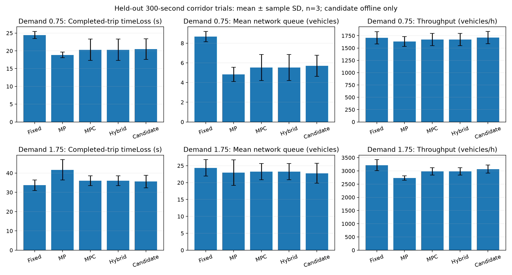

# Controller benchmark report — Phase 4

Thirty matched final trials completed: five modes ×two demand scales ×three held-out seeds. The learned candidate ran **offline through MPC and the independent supervisors**; it was never installed in the operational coordinator. There is no qualified-policy operational result.

| Demand | Controller | Completed timeLoss s | Mean / max queue | Throughput veh/h | Unfinished trips |
|---|---|---|---|---|---|
| 0.75 | fixed_time | 24.45 ±1.03 | 8.67 ±0.53 /23.67 ±3.21 | 1708.00 ±123.16 | 26.00 ±2.65 |
| 0.75 | max_pressure | 18.86 ±0.77 | 4.83 ±0.73 /16.67 ±4.16 | 1632.00 ±98.22 | 32.33 ±4.62 |
| 0.75 | mpc | 20.30 ±3.00 | 5.52 ±1.32 /17.00 ±4.58 | 1672.00 ±126.05 | 28.67 ±4.73 |
| 0.75 | hybrid | 20.30 ±3.00 | 5.52 ±1.32 /17.00 ±4.58 | 1672.00 ±126.05 | 28.67 ±4.73 |
| 0.75 | candidate | 20.46 ±2.91 | 5.70 ±1.07 /16.00 ±3.61 | 1712.00 ±126.05 | 25.33 ±4.16 |
| 1.75 | fixed_time | 33.69 ±2.74 | 24.36 ±2.43 /45.33 ±3.06 | 3216.00 ±207.85 | 81.00 ±6.24 |
| 1.75 | max_pressure | 41.65 ±5.30 | 22.94 ±3.78 /40.67 ±5.69 | 2728.00 ±81.68 | 94.33 ±5.77 |
| 1.75 | mpc | 36.08 ±2.55 | 23.23 ±2.39 /44.33 ±2.08 | 2980.00 ±143.16 | 90.67 ±1.53 |
| 1.75 | hybrid | 36.08 ±2.55 | 23.23 ±2.39 /44.33 ±2.08 | 2980.00 ±143.16 | 90.67 ±1.53 |
| 1.75 | candidate | 35.61 ±3.25 | 22.77 ±2.97 /42.33 ±7.09 | 3064.00 ±152.89 | 90.00 ±2.00 |

Entries are mean ±sample standard deviation across seeds2901,2902,2903. Horizon300 simulated seconds, one-second simulation step, five-second candidate recommendations, demand scales0.75 and1.75. Same network/route inputs, SUMO1.28.0, seeds and horizon in each mode. No warm-up exclusion. Hint-free hybrid is the existing MPC executable path with no learned recommendation; equivalent outcomes are expected. Baselines are native fixed-time, supervised Max-Pressure and constrained MPC. Actual control timing is not tuned after seeing final results.

Native SUMO fixed-time uses42s green /3s yellow /42s green /3s yellow, without explicit all-red stages. Adaptive modes use the independently supervised10–45s green,3s yellow and2s all-red ring. Thus this is a comparison of installed research modes, not a pure algorithm ablation with identical clearance budgets. Candidate-versus-MPC qualification uses the same adaptive program/constraints in both arms. A future fixed-time baseline with matched clearance rules would isolate algorithm effects more closely.

| Demand | Seed | Candidate −MPC timeLoss s | Throughput difference vehicles |
|---|---|---:|---:|
| 0.75 | 2901 | 1.1506 | 4 |
| 0.75 | 2902 | -1.8375 | 3 |
| 0.75 | 2903 | 1.1680 | 3 |
| 1.75 | 2901 | 0.7296 | 6 |
| 1.75 | 2902 | 0.5302 | 8 |
| 1.75 | 2903 | -2.6658 | 7 |

Three seeds support descriptive variability, not a claim of statistical significance or general traffic superiority. Seed/demand partitions were recorded before testing; the selected checkpoint was frozen using separate selection seeds2801-2803 at demand1.0. Other candidates were not selected using final test data.

| Demand | Controller | Mean /p95 completed wait s | Worst observed wait s | Worst service age s | Spillback edge-s | Supervisor rejections | Mean /p95 control ms |
|---|---|---|---:|---:|---|---:|---|
| 0.75 | fixed_time | 16.34 ±0.66 /42.50 ±1.32 | 57.00 | 48.00 | 0.00 ±0.00 | n/a | 0.00 ±0.00 /0.00 ±0.00 |
| 0.75 | max_pressure | 8.53 ±0.27 /21.95 ±1.95 | 35.00 | 21.00 | 0.00 ±0.00 | 0 | 1.30 ±0.02 /1.62 ±0.01 |
| 0.75 | mpc | 9.88 ±1.67 /24.33 ±3.22 | 38.00 | 49.00 | 0.00 ±0.00 | 0 | 2.74 ±0.29 /6.21 ±1.30 |
| 0.75 | hybrid | 9.88 ±1.67 /24.33 ±3.22 | 38.00 | 49.00 | 0.00 ±0.00 | 0 | 2.73 ±0.30 /6.15 ±1.31 |
| 0.75 | candidate | 10.54 ±1.52 /28.63 ±3.51 | 48.00 | 52.00 | 0.00 ±0.00 | 0 | 4.14 ±0.30 /8.52 ±0.50 |
| 1.75 | fixed_time | 22.44 ±1.82 /45.38 ±1.51 | 73.00 | 48.00 | 0.00 ±0.00 | n/a | 0.00 ±0.00 /0.00 ±0.00 |
| 1.75 | max_pressure | 21.76 ±3.16 /48.02 ±2.76 | 69.00 | 24.00 | 0.00 ±0.00 | 0 | 1.59 ±0.05 /2.14 ±0.12 |
| 1.75 | mpc | 20.96 ±2.20 /53.35 ±0.56 | 78.00 | 51.00 | 0.00 ±0.00 | 0 | 4.37 ±0.32 /9.06 ±0.54 |
| 1.75 | hybrid | 20.96 ±2.20 /53.35 ±0.56 | 78.00 | 51.00 | 0.00 ±0.00 | 0 | 4.23 ±0.10 /9.11 ±0.29 |
| 1.75 | candidate | 20.61 ±2.43 /57.77 ±8.48 | 93.00 | 57.00 | 0.00 ±0.00 | 0 | 5.08 ±0.38 /9.45 ±0.26 |

Worst observed waiting includes partial waiting of unfinished inserted trips; virtual insertion backlog is separate. Worst service age is the largest observed green-group service age across all three trials,not a pedestrian waiting bound. Other detail entries show mean ±sampleSD across three trial metrics. Native fixed-time issues no adaptive supervisor writes,so its action-rejection counter is not applicable. Raw rows also include waiting Gini,mean/max/end pending demand,inference and total five-second decision-compute timings.

Observed insertion demand matched across all five modes in6/6 seed/load blocks. Hint-free MPC/hybrid traffic metrics were identical in6/6 blocks. These are measured integrity checks,not assumed properties of arbitrary future runs.

No untrained-actor or constant-hold/release ablation was run. Any measured candidate benefit is therefore a property of this saved checkpoint/controller combination; it does not prove that learning, rather than initialization or a static timing preference, caused the benefit. Those controls are required before attributing gains specifically to MAPPO learning.

## Measurement definitions and limitations

Vehicle delay is completed-trip SUMO `timeLoss`, distinct from waiting time and insertion delay. Unfinished trips are right-censored and listed separately. `meanObservedTimeLossIncludingUnfinished` records partial observed timeLoss, not eventual full-trip delay. `meanDepartDelaySeconds` reports insertion delay for recorded trips; vehicles still waiting to depart may be absent. Different controllers can change insertion capacity even with matched configured demand. No demand-normalized superiority inference is made.

Current Poisson rates represent mean gaps6,8,9,12,7,11s (base2591.558veh/hour),then scale0.75/1.75. These are designed synthetic loads,not field calibration. Every trial records actual inserted (`departedVehicles`) and pending vehicles waiting for insertion,with mean/max/end backlog. `observedInsertionDemandVehicles` is inserted plus end-pending demand,not a future-flow count. A same-seed100s probe inserted59 versus121 vehicles at the two scales,pending0 versus5. The earlier legacy overload results are separately labeled in `research/phase4-saturated` and are not mixed into this load sweep.

These experiments use SUMO observations/state estimates and measured-arrival fallback; no genuine historical/weather dataset or camera-derived control input was enabled. They do not measure forecasting accuracy, camera errors or robustness to changed perception/weather. Those integrations remain verified demonstration paths rather than experimentally validated performance factors here.

Queues are halted approach vehicles summed over both junctions, sampled every second; report time mean and maximum. Throughput is actual arrivals ×3600/300. Waiting fairness is reported as completed-trip mean/p95/max waiting, maximum approach mean wait, maximum service age, and descriptive waiting Gini including unfinished recorded trips. Spillback is downstream-edge indicator seconds. These proxies are not proof of fairness or network stability.

Control latency is `HybridNetwork.before_step` for both junctions, excluding simulator stepping, telemetry reads and policy inference. Mean/p95/max are available per trial; they are not full end-to-end latency. Separate policy-inference mean/p95 and total control-compute mean/p95 per five-second decision are also recorded. The latter sums inference and five before_step calls, excluding simulation and telemetry. Fallback controller-seconds measure time showing fallback diagnostics, not a count of solver timeout events. Up to three experiment processes shared the machine; CPU timings reflect that environment, not isolated real-time guarantees. Solver timeouts and supervisor rejections retain safe behavior. Detailed supervisor accepted/rejected counts and safety faults are preserved.

Corridor pedestrian constraints and emergency response are **not applicable/not measured** because these demand files contain neither. Separate baseline pedestrian/emergency API demonstrations passed; emergency request-to-approach-completion was 70.0s at seed95. This is not a candidate-policy emergency comparison. Protected slow-walker, clearance, emergency-stage and fault fallback regressions are included in the backend suite.

## Machine-readable evidence

[Trial CSV](research/phase4/trials.csv), [full trials JSON](research/phase4/trials.json), [aggregated results](research/phase4/benchmark-summary.json), [qualification](research/phase4/policy-qualification.json). Raw SUMO tripinfo is in `.checkpoints/phase4-demand-corrected/trips`; individual trials and source/version provenance in `.checkpoints/phase4-demand-corrected/trials`. SVG plots accompany PNG exports. The recovery artifact archive includes these raw data.

Reproduce cached matching experiments after training: `./backend/.venv/Scripts/python.exe scripts/run_phase4_experiments.py`. Rebuild plots/reports: `./backend/.venv/Scripts/python.exe scripts/summarize_phase4.py`, then `./backend/.venv/Scripts/python.exe scripts/report_phase4.py`. Use a new output location for a changed protocol; cache mismatches are rejected.
