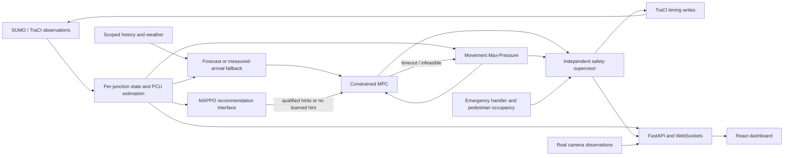

# Phase 4 research update

This section supersedes Stage3 research/Git status below; Stage3 demonstration results remain historical evidence. Fixed repeated postponement of an already-due signal expiry: the controlled release probe observed its first phase change at12s rather than46s, without weakening timing or clearance checks. Corrected Poisson rate/mean-gap units; exact legacy overload inputs and completed stress results remain preserved separately. Earlier research weights were invalidated by route/controller fingerprints. Three corrected-architecture/demand MAPPO runs completed,1024 joint decisions each;30 matched final corridor trials and separate held-out safety trials are recorded. **MAPPO remains unqualified and operationally disabled.** Read [MAPPO_TRAINING_REPORT.md](MAPPO_TRAINING_REPORT.md), [CONTROLLER_BENCHMARK_REPORT.md](CONTROLLER_BENCHMARK_REPORT.md), [POLICY_QUALIFICATION_REPORT.md](POLICY_QUALIFICATION_REPORT.md) and [RESEARCH_NEXT_STEPS.md](RESEARCH_NEXT_STEPS.md).

Final backend: 108 tests, 0 failures, 0 errors, 0 skipped, 245.78 s. Four Edge/browser tests passed in32.3s; frontend build,TypeScript,eight frontend groups,pip check,startup smoke and all eight fresh A-H external demos passed. Git2.55.0.windows.5 is installed; exact Stage3 archive preserved as local tag `stage3-verified-demo`, with new local research history. No earlier Git history existed in this export; no remote or push. Recovery pointer: `.checkpoints/PHASE4_RECOVERY.json` (created after final reporting).

Startup remains `./backend/.venv/Scripts/python.exe scripts/run_dev.py`; operational fallback and original network files are preserved. Research evidence/plots: `research/phase4`; raw data/checkpoints `.checkpoints/phase4-demand-corrected`. Current limitations include limited training, no qualified learned policy, one benchmark topology, short cold-start/censored experiments, and no candidate pedestrian/emergency qualification.

## Current verified external demonstrations

| Case | Scenario | Simulated seconds | Arrivals | Result |
|---|---|---:|---:|---|
| A | normal_adaptive | 140.0 | 50 | passed |
| B | unequal_demand | 140.0 | 45 | passed |
| C | blocked_exit_spillback | 80.0 | 11 | passed |
| D | pedestrian_protection | 180.0 | 38 | passed |
| E | emergency_priority | 180.0 | 35 | passed |
| F | multi_junction | 180.0 | 103 | passed |
| G | sensor_controller_fallback | 80.0 | 24 | passed |
| H | recorded_camera | video | n/a | passed |

---

# FINAL DEMO REPORT - SYNCHROFLOW AI

Release date: 2026-10-22 (Asia/Calcutta). This is an integrated, runnable **research demonstration prototype**. It is not road-certified, production-safe, a fully trained MAPPO controller or proof of comparative optimization quality.

## 1. System architecture



The same HybridNetwork control code runs the operational A0/B0 corridor and CTDE training environment. Camera mode remains observational and does not replace SUMO's pedestrian, signal or internal-occupancy safety observations.

## 2. Implemented features

React dashboard, FastAPI lifecycle/status APIs, real SUMO simulation and WebSocket telemetry; per-junction counts/queues/waits, vehicle classes and measured PCU arrival rates; scoped historical CSV ingestion and weekday/time forecasts; optional manual/Open-Meteo weather and heuristic uncertainty; movement Max-Pressure and constrained MPC; MAPPO shared actor/central critic, PPO/GAE, checkpoints and gated inference; emergency priorities and protected pedestrian stages; independent program/timing/phase/occupancy/fairness gates; recorded-video YOLO11n/ByteTrack counting, calibration hooks and conservative camera association/fallback.

Final stabilization fixed a real occupancy-unit defect. In the installed SUMO 1.28, TraCI edge occupancy was 0.90609555 for 220 m of vehicle bodies on a 242.8 m lane. The backend had labeled that ratio percent and compared it with 80. It now reports 90.6096% and activates spillback/zero receiving supply. The fixture verifies the measurement rather than relying on an ambiguous Python docstring. [SUMO lane occupancy definition](https://github.com/eclipse-sumo/sumo/blob/main/docs/web/docs/TraCI/Lane_Value_Retrieval.md).

Live phase/state/program feedback is now checked before stepping, and the write boundary rejects unapproved programs as faults. Runtime feedback faults pause before simulated time advances. Startup now checks dependencies/SUMO and actual backend/frontend readiness, reports actual controller/simulation state and preserves occupied ports. Dashboard selectors follow externally started API demos.

## 3. End-to-end integration and repeatable demos

The external demo runner uses real HTTP, WebSocket and SUMO connections. Seed 95 and paused starts make initial conditions explicit. It refuses to take over an active SUMO/camera session, saves progress after every case, and leaves SUMO/cameras stopped. Actual release results:

| Demo | Scenario | Actual outcome | Status |
|---|---|---|---|
| A | normal_adaptive | 140 s; 43 arrivals; EXAMPLE forecast reached MPC | Passed |
| B | unequal_demand | 140 s; 31 arrivals | Passed |
| C | blocked_exit_spillback | 80 s; 11 arrivals; south occupancy 90.61%, north supply zero | Passed |
| D | pedestrian_protection | 180 s; 47 arrivals | Passed |
| E | emergency_priority | 180 s; 48 arrivals; emergency completed | Passed |
| F | multi_junction | 180 s; 192 arrivals | Passed |
| G | sensor_controller_fallback | 80 s; 37 arrivals | Passed |
| H | Recorded-video detection | Real YOLO/ByteTrack API observations; stop fallback | Passed |

REST/WebSocket simulated time and metrics matched in A-G; permission checks remained compatible. Case A deliberately enabled **artificial, explicitly labeled history/weather** for MPC, verifying the complete prediction path. It restores forecasting disabled afterward. No real historical dataset is claimed. Case H used actual recorded video and pretrained weights, not simulated detections. Source evidence: `.checkpoints/stage3-demo-results.json`.

Run all cases against the standard running backend:

```powershell
.\backend\.venv\Scripts\python.exe scripts/demo_release.py --base-url http://127.0.0.1:8001/api/v1 --with-example-forecast
```

Run one case using `--scenario A` through `--scenario H`. Default report: `.checkpoints/stage3-demo-results.json`; use `--output` to preserve another run. The example-forecast flag explicitly permits demo data to reach MPC only in A. Omit it for ordinary observed-arrival fallback.

| Demo | Reproducible selection | Expected observations | Limitation |
|---|---|---|---|
| A | `vehicle`, hybrid, 140 s; optional example-forecast flag | Queue estimates, MPC decisions, supervised actions, streamed predictions | Example history/weather are demonstration fixtures |
| B | `unequal`, hybrid, 140 s | North demand 1500 veh/h versus south 150 and east/west 120; north arrival estimate exceeds east | Scripted SUMO demand, no measured benefit claim |
| C | `spillback`, hybrid, 80 s | 44 tightly spaced cars stopped on S_out; occupancy about 90.61%, spillback triggered, north supply zero and queues | Deliberate blocked-receiver stress fixture; no congestion realism claim |
| D | `pedestrian`, hybrid, 180 s | Real walkers, exclusive walk/15 s clearance, compatible permissions | Supplied network only; stopped-walker holds separately regression-tested |
| E | `pedestrian`, hybrid, east emergency priority 3 | Validated emergency request, cycle-preserving priority, completion/recovery | Does not bypass queues, fairness, pedestrian clearance or red lights |
| F | `corridor`, hybrid, 180 s | A0/B0 signals, queues, MPC/Max-Pressure and supervisor decisions | No learned policy activated; corridor has no pedestrians |
| G | `corridor`, hybrid, `mpc_budget_ms=0`, 80 s | Max-Pressure timeout fallback; unavailable camera data falls back to SUMO | Controlled missing-input/solver-budget tests, not live cable fault validation |
| H | Configured recorded video | Real vehicle tracks/classes/confidences and counts; stopped camera becomes unavailable | No field precision/recall or metric calibration verification |

The UI Network selector includes the normal, pedestrian, corridor, unequal-demand and blocked-exit fixtures. Choose Hybrid before Start for adaptive demos. These added demo configs reference unchanged original network files.

## 4. Controller operating modes

- `sumo_fixed_time`: original native SUMO program baseline, without adaptive timing writes.
- `max_pressure`: cyclic green-extension recommendations from actual movement queue pressure and receiver observations.
- `mpc`: finite candidate timing optimization over 60 seconds, optional forecast means, observed-PCU fallback, Max-Pressure timeout/infeasibility fallback.
- `hybrid`: MPC plus the qualified MAPPO coordination interface. Without an eligible policy it runs supervised MPC with no learned hint.

All controller-originated program/duration writes are inside independent supervisors. MAPPO never writes phases. Supervisors enforce approved state/program, legal cyclic transitions, 10-45 s vehicle green, >=3 s yellow, >=2 s all-red, maximum-red fairness and occupancy holds. Supplied pedestrian geometry requires 15 s clearance at the configured design speed/margin. Safety infeasibility pauses; it does not invoke an unchecked controller.

## 5. MAPPO training status

Environment, local actors, global critic, joint recommendations, rewards, actor/critic updates, checkpoint save/load and MPC integration are executable and regression-tested. Historical Stage 2 smoke trained 64 joint decisions across seeds 84/85; an identical repeat matched all parameters/update reports. This does **not** establish a useful learned policy.

The Stage 3 occupancy correction changes normalized observations and receiver supply. Older smoke weights are unqualified and must not be relabeled current validated weights. Current qualification again reports numerical checks passed but `eligibleForEvaluation: false`, `insufficient_training`. The evaluation gate refuses them. The positive qualified-policy runtime path still requires genuinely trained weights and held-out qualification. Training/checkpoint smoke tests use the corrected current code; full training and performance benchmarking remain deferred.

## 6. Camera AI verification status

Actual YOLO11n CPU detection and ByteTrack inference ran again: **60 frames, 260 tracked observations, 13 unique IDs**. Real API workers, dashboard counts, persistent IDs, line/region geometry, class support and missing/stale/stop fallback are tested. The available road clip is 3840x2160 at 25 FPS. Classification supports COCO bicycle/car/motorcycle/bus/truck; no separate auto-rickshaw class.

Artifacts: `.checkpoints/perception/stage3-road-inference.jsonl`, `road.mp4`, `yolo11n.pt`; dependency versions in the recovery artifact manifest/freeze. Camera-derived metric queues/waits/density require site calibration and remain unverified in physical units. Live USB/RTSP hardware, field accuracy, rain/night robustness and real multi-camera association accuracy remain unverified. A missing camera config is an explicit H skip; invalid configured sources fail visibly.

## 7. Weather and forecasting status

Historical CSV ingestion is scoped by junction (`center` default, `A0`/`B0` optional), excludes future/incomplete/stale samples and rejects invalid/duplicate/overlapping rows. Seasonal weekday/half-hour shrinkage forecasts emit PCU/s trajectories and heuristic confidence/ranges. Missing inputs use measured PCU arrivals. Rainfall/monsoon/missing weather widen uncertainty; learned rain effects require sufficient wet/dry records. Bounds are not calibrated probabilities or robust MPC.

A live Open-Meteo request succeeded again with verified system TLS trust (returned 0.0 mm/h in its snapshot). No API credentials were needed. Independent provider outage/conversion tests pass. Case A uses clearly labeled artificial history/manual rain only to verify reproducible integration; normal API defaults disable forecasts and block example data from MPC. No real historical forecasting accuracy or exhaustive weather robustness is established. Weather/history/settings are process-local and must be reloaded after restart.

## 8. Safety limitations

Simulation research only. The independent software gate is tested on supplied scenarios; it is not independent certified hardware or formal production safety assurance. Pedestrian design speed/clearance, PCU weights, saturation flow, spillback threshold and reward weights are research parameters. Yielding interactions follow SUMO permissions. MPC uses a simplified fluid queue model and static route-weighted receiver heuristic, not unrestricted movement-flow optimization. A blocked crossing can make fairness infeasible and pause the simulation. Emergency priority retains cyclic order and cannot clear physical queues instantly. Camera observations never command road signals. No real-road deployment certification, guaranteed camera accuracy or optimization superiority is claimed.

## 9. Test results

Before stabilization: 90 backend tests passed in 294.39 s; all 159 source hashes and prior source/artifact recovery copies matched. Final verification: **97 passed, 1 existing warning, 350.63 s**. Isolated browser: **4 passed in 31.2 s**. Live browser: **4 passed in 30.4 s**. Production build, TypeScript, eight frontend test groups and pip check passed. Seven focused startup/demo tests passed; actual launcher startup/readiness/cleanup smoke passed. All eight A-H external demos passed, including real video.

Exact machine-readable evidence: `.checkpoints/stage3-backend-tests.xml`, `stage3-baseline.xml`, `stage3-demo-results.json`, `stage3-weather-check.json`, `stage3-policy-qualification.json`, `stage3-policy-evaluation-gate.json`, and the final verification summary/recovery manifest.

## 10. Startup and recovery

From the project folder:

```powershell
.\backend\.venv\Scripts\python.exe scripts/run_dev.py
```

Open http://127.0.0.1:3001. Backend docs: http://127.0.0.1:8001/docs. Startup reports actual dependencies, SUMO version, backend/frontend readiness, controller mode and simulation state. Default launch is stopped fixed-time; select a network and Hybrid to begin an adaptive demo. Ctrl+C cleans up this launcher's own SUMO/cameras and child servers. Occupied ports fail clearly without stopping another service; use `--backend-port 8020 --frontend-port 3020` when needed. Run `--smoke-test` for startup/readiness/cleanup verification.

Optional camera demo (assets must exist):

```powershell
$env:SYNCHROFLOW_CAMERA_CONFIG=(Resolve-Path '.checkpoints/perception/cameras-api.json').Path
.\backend\.venv\Scripts\python.exe scripts/run_dev.py
```

Read RUN_INSTRUCTIONS.md for dependency installation, camera-config regeneration after restoring to a different path, exact test commands and individual API demos. Source-only recovery excludes dependencies/weights/video; the separate artifact archive includes demo assets and test evidence. Git was unavailable and no history was initialized/replaced. `.checkpoints/STAGE3_RECOVERY.json` records verified SHA-256 source/artifact archives and separately copied recovery locations. Prior checkpoints are preserved. Restore into a new directory and verify manifests before installing dependencies; never extract over current work.

## 11. Known defects and operational constraints

No blocking defect was observed in the verified A-H paths. Non-blocking warnings remain: one Starlette/httpx deprecation warning and Vite config/chunk-size warnings (frontend bundle about 1 MB before gzip). Live camera drivers can block and require process restart; RTSP is unverified. Calibration, real historical datasets and trained qualified MAPPO weights are missing. Audit/history/forecast state is bounded or process-local, not a production persistent database. One backend worker is required because TraCI ownership and simulation state are process-local. Existing demonstration tabs remain labeled synthetic. Stopped-run telemetry/metrics are historical. Local services require restart after process/session shutdown.

## 12. Remaining research work

Train MAPPO meaningfully, use disjoint held-out seeds, qualify the changed architecture and validate positive runtime inference; calibrate arrival/saturation/receiver/reward models and forecast uncertainty; evaluate across larger networks, seeds and demand patterns; measure real camera precision/recall, ID switches, queue/wait accuracy and overlapping-camera association; collect genuine historical/weather datasets and perform held-out forecast evaluation; validate combined multi-junction pedestrian/emergency networks and investigate persistence, security and production safety independently. These remain research work rather than implied demo release features.
