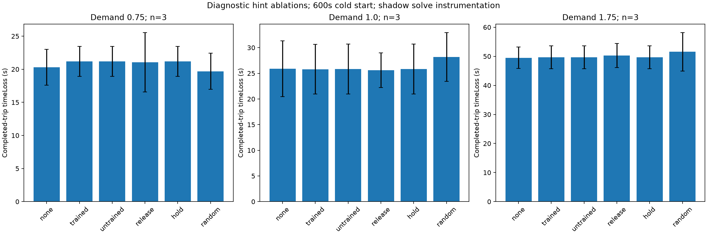

# MAPPO diagnostic report — Phase5

## Executable path and influence

SUMO per-junction observations → shared actor8→32→32→2 → release/hold preferences → HybridNetwork.before_step(training_actions) → constrained MPC candidate objective → selected remaining green → independent supervisor.validate_duration/apply_duration → TraCI setPhaseDuration. No research actor writes signals directly. Emergency handling precedes normal MPC; clearance/minimum service/fairness can remove hint influence. The runtime qualification gate stays intact.

At each normal MPC call, a no-write shadow solve evaluated the same observed state without hints; diagnostics were restored before the actual solve. Denominator below includes only pairs where both solves succeeded as constrained MPC. These are recommendation changes, not independent causal traffic counterfactuals. The full recommendation traces plus retained supervisor decisions are archived. End-to-end traffic effects come from separate matched rollouts. Shadow overhead affects latency/timeout exposure; do not treat instrumented timings as operational timing.

| Load | Hint | Delay mean ±SD s | Changed /eligible MPC calls | Worst service age s |
| --- | --- | --- | --- | --- |
| 0.75 | none | 20.305 ±2.722 | 0/520 (0.0%) | 48.0 |
| 0.75 | trained | 21.201 ±2.265 | 814/1171 (69.5%) | 55.0 |
| 0.75 | untrained | 21.201 ±2.265 | 814/1172 (69.5%) | 55.0 |
| 0.75 | release | 21.055 ±4.503 | 75/250 (30.0%) | 29.0 |
| 0.75 | hold | 21.201 ±2.265 | 815/1173 (69.5%) | 55.0 |
| 0.75 | random | 19.699 ±2.751 | 267/490 (54.5%) | 36.0 |
| 1.0 | none | 25.885 ±5.438 | 0/644 (0.0%) | 55.0 |
| 1.0 | trained | 25.799 ±4.849 | 482/1065 (45.3%) | 55.0 |
| 1.0 | untrained | 25.820 ±4.864 | 484/1064 (45.5%) | 55.0 |
| 1.0 | release | 25.595 ±3.389 | 128/458 (27.9%) | 47.0 |
| 1.0 | hold | 25.820 ±4.864 | 484/1064 (45.5%) | 55.0 |
| 1.0 | random | 28.189 ±4.766 | 235/635 (37.0%) | 55.0 |
| 1.75 | none | 49.487 ±3.696 | 0/1256 (0.0%) | 51.0 |
| 1.75 | trained | 49.667 ±3.972 | 264/1525 (17.3%) | 55.0 |
| 1.75 | untrained | 49.667 ±3.972 | 264/1524 (17.3%) | 55.0 |
| 1.75 | release | 50.284 ±4.178 | 139/1123 (12.4%) | 55.0 |
| 1.75 | hold | 49.667 ±3.972 | 265/1525 (17.4%) | 55.0 |
| 1.75 | random | 51.551 ±6.652 | 170/1184 (14.4%) | 55.0 |

Frozen Phase4 actor joint action counts across all nine diagnostic trials: `{"1,1": 1080}`. Exact tripinfo attribute equivalence to constant hold: 8/9; to untrained seed41 actor: 8/9. Exact equality is checked on sorted completed/unfinished trip attributes,not assumed from mean delay. It does not prove identical full trajectories. Full action histograms and traces remain in raw evidence.

The same hint sequence need not yield identical outcomes under timed solver fallback. The trained medium-load seed5102 trial recorded one fallback controller-second,while its constant-hold counterpart recorded none. Small differences between these constant-hint runs are not evidence of adaptive learned coordination. The single seed41 untrained initialization is a control,not a population estimate over untrained policies.

For10037 retained accepted MPC supervisor decisions,the applied remaining duration matched the corresponding recorded actual MPC recommendation. Supervisor histories retain100 entries per junction,so this is a retained-history check,not a claim that every write was independently archived in that history. Shadow calls never invoke actuation.

## Learning and observation diagnosis

The two-action representation changes a preference penalty over remaining-green choices1/2/5/10s; it neither selects an arbitrary phase nor directly commits the planned next green. MPC replans every second, and recommendations are retained for five-second decisions. Actions during minimum service/clearance/expiry have no normal MPC control effect. This limits temporal credit assignment, but measured influence rules out a universally disconnected hint interface.

Actor inputs omit explicit maximum-red/service age, directional receiver occupancy, arrivals/forecast uncertainty, emergency and pedestrian state and neighboring-junction measurements. Only four queues, two green flags, remaining time and mean receiver occupancy are present. Reward penalizes service age and waiting that the actor cannot uniquely infer from these inputs. The centralized critic sees concatenated local inputs, not these missing hidden variables. Directional receiver averaging loses information. These are code-observed observability limitations, not a demonstrated quantitative cause of failure.

Seed5199 real64-decision diagnostic: actor gradient norm0.080023; weighted critic44.669220; joint clip multiplier0.011193. Mean return-31.284 versus critic prediction-0.563; value MSE1187.104. Reward scale/critic fit remain concerns. Adam partly cancels uniform gradient scaling, so raw clipping is not by itself proof of actor starvation.

Restored-optimizer four-epoch paired update probe:

| Clip variant | Actor parameter delta L2 | Final critic loss | Final entropy | Changed final-state greedy actions |
| --- | --- | --- | --- | --- |
| joint_clip | 0.023550 | 1185.357 | 0.691162 | 0 |
| separate_clip | 0.047216 | 1185.357 | 0.689377 | 0 |

Actor update-direction cosine:-0.593000. This is one genuine rollout and four epochs with restored optimizer state; no updated weights were saved or activated by this probe.

This supported one isolated independent-clipping training experiment. It does not establish optimizer superiority: new models use different initial seeds from Phase4, and no matched full-training joint-clipping cohort was run. Changes to reward/features/action space require new controlled training, not tuning on final tests. Training rewards are not qualification evidence. See [PHASE5_EXPERIMENT_RESULTS.md](PHASE5_EXPERIMENT_RESULTS.md).

The new models' greedy actions on the same diagnostic observations were compared with their own initializations:

| Seed | Local actor decisions | Initial holds | Trained holds | Greedy choices changed |
| --- | --- | --- | --- | --- |
| 61 | 2160 | 7 | 0 | 7 |
| 71 | 2160 | 2160 | 2160 | 0 |
| 81 | 2160 | 2 | 2160 | 2158 |

This separates parameter movement from changes to deployed greedy choices. It is descriptive diagnostic evidence,not held-out qualification or a model-selection criterion. Probability ranges are retained in machine results.

## Evidence-supported next work

Inspect greedy action collapse and static/untrained equivalence in `research/phase5/results.json` and raw jointActionCounts before spending more training. Add explicit service-age and directional receiving state only in a versioned offline observation experiment, with new model compatibility hashes. Diagnose critic normalization/value learning with paired training seeds. Compare richer timing actions only after state/credit-assignment ablations, keeping MPC/supervisor authority. No additional speculative production features were added.
