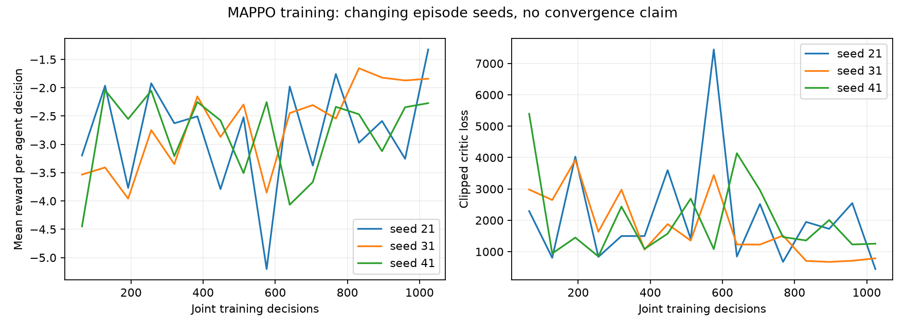

# MAPPO training report — Phase 4

Three independent CPU training runs completed using corrected SUMO occupancy observations,phase-expiry execution and Poisson demand rates. They are **unvalidated candidate policies**, not evidence of convergence or a useful operational controller. Operational MAPPO remains disabled.

| Model seed | Episode seeds | Decisions | Wall seconds | First / last critic loss | Final checkpoint |
|---|---|---:|---:|---|---|
| 21 | 21000-21015 | 1024 | 675.19 | 2295.16 / 446.04 | update-0016.pt |
| 31 | 31000-31015 | 1024 | 667.24 | 2981.12 / 787.24 | update-0016.pt |
| 41 | 41000-41015 | 1024 | 682.11 | 5396.44 / 1254.71 | update-0016.pt |

Total measured update wall durations: 2024.55 seconds; processes ran concurrently, so this sum is not elapsed calendar time. Each run has 16 episodes of 320 simulated seconds, 64 five-second decisions per episode: 1024 joint decisions /2048 agent samples per model. The 64-decision seed-11 pilot is excluded from selection. No earlier pre-correction weights were resumed.

## Architecture and update audit

Shared actor: 8 local inputs →32 tanh →32 tanh →2 categorical actions. Central critic: 16 joint inputs →32 tanh →32 tanh →2 values. Local observations are four queues /20, two green indicators, remaining signal time /45, and mean downstream occupancy fraction. Actions are release/hold preferences; MPC may override and the independent supervisor checks timing writes. There is no actor-to-TraCI actuation.

PPO: Adam 0.0003, four full-batch epochs/update, clip 0.2, clipped value loss coefficient 0.5, entropy 0.01, gradient norm clip 0.5, gamma 0.99, GAE lambda 0.95. GAE true-terminal masking and time-limit bootstrapping match hand calculations. Actor and critic both change in real SUMO integration tests. Checkpoint restoration covers weights, optimizer, training count and Torch RNG; a separate test verifies sampled-action replay. No minibatch shuffling, value normalization, learning-rate decay or convergence claim. Large critic losses and shared gradient clipping remain a learning-quality concern.

Reward is unchanged: per-second -(0.1 queue +0.01 sum current waiting time +2 spillback indicators +maximum service age /120 +100 incompatible permissions), plus arrivals divided among two agents. Collision/permission faults abort. These weights are research assumptions, not a validated utility model.

## Reproducibility and evidence

Replay model seed 21 /episode 21000 for64 joint decisions: bit-identical parameters = **True**; maximum parameter difference 0.0. This single replay does not establish determinism across hardware or timing-dependent solver timeouts. Per-update checkpoints and progress/configuration logs: `.checkpoints/phase4-demand-corrected/train-21`, `train-31`, `train-41`. Each update is preserved without overwriting older weights. Training source hashes are recorded at process start. Corrected runs used a frozen controller/training driver. Resume requires the exact recorded source configuration; otherwise start a new run.

An earlier three-seed1024-decision cohort is preserved under `.checkpoints/phase4`. Development evaluation exposed a phase-expiry defect: resetting remaining=1 at an already-due phase postponed release. The controlled seed701 probe observed the first phase change at46s before correction and12s afterward. The fix lets the independently approved cyclic program execute an already-due transition, with timing bounds and clearance unchanged. Its regression covers all six stages. Earlier final benchmarking was interrupted; those weights were invalidated by the changed controller fingerprint. No pre-fix policy was activated or qualified. Current reports use only fresh corrected runs and fresh development/final seeds; pre-fix evidence remains separate.

A second complete cohort/study is preserved under `.checkpoints/phase4-final` and `research/phase4-saturated`. It exposed a separate demand configuration defect: legacy `exp(6)`-style flow values were rates in vehicles/second,not mean headways. Their total was190800veh/hour before scaling,so both test strata were extreme insertion-limited overload. That candidate failed2% delay-reduction screening (-0.06695% and+0.37398% reduction); all30 stress trials and three safety trials nevertheless remain published as specifically labeled stress evidence. The primary study here retrains from scratch after correcting rates to reciprocal mean gaps and adding route/config bytes to qualification fingerprints. The exact legacy route/config is preserved under `corridor.legacy-saturated.*`. [SUMO flow parameter semantics](https://sumo.dlr.de/docs/Definition_of_Vehicles%2C_Vehicle_Types%2C_and_Routes.html).

Hardware: AMD Ryzen 7 7445HS, 6 cores/12 logical CPUs, about16GB RAM; CPU-only Torch. Exact Python/Torch/NumPy versions and source hashes: [training-summary.json](research/phase4/training-summary.json); complete installed freeze `.checkpoints/phase4-demand-corrected/environment-freeze.txt`. SUMO1.28.0; Python3.11.9. Measured update durations include SUMO initialization, TraCI, control, telemetry, PPO update and checkpoint saving. They exclude Python imports, model construction and between-update reporting/cleanup. Torch intra-op threads=1 per model process.

Hardware also includes an NVIDIA GeForce RTX4050 Laptop GPU,6141MiB reported by nvidia-smi,driver573.05. Installed Torch2.14.1+cpu has no CUDA training support. A separately labeled synthetic64-decision/four-epoch neural-update resource probe took0.0280s on CPU and saved no checkpoint. Compared with the primary38.44s SUMO pilot, this supports retaining the working CPU environment for this small network; no GPU speed comparison was run. Device details and the resource probe are preserved with raw artifacts. GPU acceleration of larger learners/perception remains separate work.



Changing episode seeds make the reward curve unsuitable as a controlled performance comparison. Selection used seeds2801-2803, demand1.0,300s; final held-out tests used2901-2903, demand0.75/1.75,300s. Safety qualification used2951-2953,240s. Selected checkpoint: `.checkpoints\phase4-demand-corrected\train-41\update-0016.pt`. Selection was frozen before final testing. All seeds, parameters, metrics and checkpoint SHA-256 are preserved in machine evidence.

## Reproduce

```powershell
$env:DEBUG='false'
./backend/.venv/Scripts/python.exe scripts/research_phase4.py train --seeds 51 61 71 --updates 16 --rollout 64
```

Use new seeds/output directories for a new experiment; existing run folders are protected. `--resume` requires the original configuration/source hashes and matching saved progress. `scripts/run_phase4_experiments.py` reproduces this specific21/31/41 protocol and caches already-completed matching trials; it does not launch training. Existing artifacts remain intact. Read PHASE4_EXPERIMENT_PLAN.md before changing partitions.
