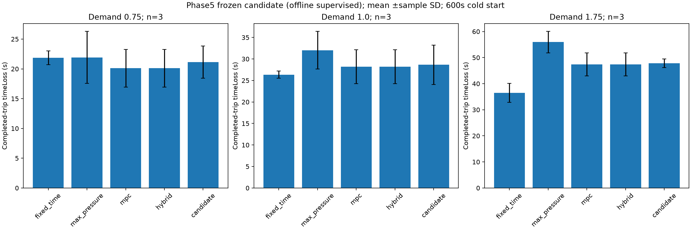

# Phase5 experiment results

Protocol: [PHASE5_EXPERIMENT_PLAN.md](PHASE5_EXPERIMENT_PLAN.md). Diagnostic seeds5101–5103,three loads,600s; gradient seed5199. Training seeds61/71/81,episode seeds61000–61015,71000–71015,81000–81015. Independent actor/critic0.5 clipping is the sole learner change; same actor/critic,reward,observations,PPO settings and safe actuation path. Each run16×64=1024 joint decisions/2048 agent samples. Limited experience is not convergence. CPU-only Torch and Phase4 environment retained; raw provenance contains versions and experimental learner SHA.

| Seed | Joint decisions | Measured update wall seconds | First →last critic loss |
| --- | --- | --- | --- |
| 61 | 1024 | 725.58 | 1186.98 → 863.47 |
| 71 | 1024 | 758.48 | 1293.99 → 1617.87 |
| 81 | 1024 | 754.40 | 1739.48 → 1998.94 |

Times include SUMO/control/training/checkpoint I/O, exclude import/model setup and inter-update reporting, and sum concurrent processes rather than calendar elapsed time. All checkpoints/progress logs preserved. Selection seeds6201–6203,demand1.0,300s; selected checkpoint `C:\Users\prana\Documents\TrafficRegulationResearch\syncroflow2AI-main\.checkpoints\phase5\training\train-61\update-0016.pt`, SHA256 `780f9bc2b55dc9cfef39097616a1413f9ff9524043388652661db82debf44173`. Selection was frozen before final seeds6301–6303 at0.75/1.0/1.75,600s. Safety seeds6501–6503,240s. Challenge seeds6401–6403. No original Phase4 held-out seeds used for tuning or new selection.

Development MPC mean timeLoss:18.883379s. Candidate scores: `{"C:\\Users\\prana\\Documents\\TrafficRegulationResearch\\syncroflow2AI-main\\.checkpoints\\phase5\\training\\train-61\\update-0016.pt": 19.37337646666758, "C:\\Users\\prana\\Documents\\TrafficRegulationResearch\\syncroflow2AI-main\\.checkpoints\\phase5\\training\\train-71\\update-0016.pt": 21.402047036631373, "C:\\Users\\prana\\Documents\\TrafficRegulationResearch\\syncroflow2AI-main\\.checkpoints\\phase5\\training\\train-81\\update-0016.pt": 21.402047036631373}`. Selection chooses the best candidate,not a claim that it already beats MPC; independent qualification still applies.

All48 saved training checkpoints passed finite weight/optimizer-state checks and loaded through the existing checkpoint format. New seed61/episode61000 first64-decision replay: bit-identical parameters=True,maximum parameter difference=0.0. One replay does not prove hardware-independent determinism or immunity to timed solver fallback. Raw audit and reproducibility records are archived.

## Held-out installed-controller comparison

| Load | Mode | Delay mean ±SD s | Throughput veh/h | Mean queue | Worst service age s |
| --- | --- | --- | --- | --- | --- |
| 0.75 | fixed_time | 21.877 ±1.159 | 1762.0 | 7.88 | 48.0 |
| 0.75 | max_pressure | 21.924 ±4.380 | 1762.0 | 5.91 | 24.0 |
| 0.75 | mpc | 20.106 ±3.147 | 1774.0 | 5.48 | 53.0 |
| 0.75 | hybrid | 20.106 ±3.147 | 1774.0 | 5.48 | 53.0 |
| 0.75 | candidate | 21.127 ±2.701 | 1774.0 | 5.58 | 39.0 |
| 1.0 | fixed_time | 26.336 ±0.835 | 2320.0 | 12.56 | 48.0 |
| 1.0 | max_pressure | 32.031 ±4.391 | 2228.0 | 12.22 | 29.0 |
| 1.0 | mpc | 28.205 ±3.929 | 2310.0 | 10.38 | 55.0 |
| 1.0 | hybrid | 28.205 ±3.929 | 2310.0 | 10.38 | 55.0 |
| 1.0 | candidate | 28.652 ±4.572 | 2304.0 | 10.46 | 55.0 |
| 1.75 | fixed_time | 36.491 ±3.671 | 3706.0 | 30.26 | 48.0 |
| 1.75 | max_pressure | 55.951 ±4.121 | 3024.0 | 29.18 | 27.0 |
| 1.75 | mpc | 47.397 ±4.450 | 3408.0 | 29.91 | 52.0 |
| 1.75 | hybrid | 47.397 ±4.450 | 3408.0 | 29.91 | 52.0 |
| 1.75 | candidate | 47.819 ±1.669 | 3366.0 | 29.75 | 38.0 |

Mean candidate delay reduction versus MPC: load0.75: -5.076%, load1.0: -1.585%, load1.75: -0.889%. A positive number means lower completed-trip timeLoss; it is not proof of significance or learning causality. Hint-free hybrid is MPC without hints. Native fixed-time uses its original clearance budget, unlike adaptive modes; candidate–MPC comparisons share the same adaptive safety program. Cold-start,censored completed trips,one corridor and n=3 limit generalization. Full metrics include throughput,unfinished trips,waiting,queues,spills,fairness,latency and fallback exposure in [trial JSON](research/phase5/trials.json) and [CSV](research/phase5/trials.csv).

Observed inserted-plus-end-pending demand matched across all five modes in9/9 seed/load blocks; actual counts are retained in results.json. Configured routes,seed,load and horizon matched in every block. Hint-free MPC/hybrid traffic metrics were identical in9/9 blocks; timed fallback can create differences despite identical control code. Pending vehicles are virtual insertion backlog,distinct from unfinished inserted trips. Completed-trip means do not include eventual delay of unfinished or not-yet-inserted vehicles.

## Asymmetric, blocked-exit and protected-user challenges

| Case | Variant | Seed | Status | Mean completed timeLoss s | Worst service age s |
| --- | --- | --- | --- | --- | --- |
| asymmetric | candidate | 6401 | completed | 22.137 | 55.0 |
| asymmetric | candidate | 6402 | completed | 24.001 | 55.0 |
| asymmetric | candidate | 6403 | completed | 24.205 | 55.0 |
| asymmetric | fixed_time | 6401 | completed | 37.918 | 48.0 |
| asymmetric | fixed_time | 6402 | completed | 41.26 | 48.0 |
| asymmetric | fixed_time | 6403 | completed | 42.08 | 48.0 |
| asymmetric | hybrid | 6401 | completed | 22.137 | 55.0 |
| asymmetric | hybrid | 6402 | completed | 24.001 | 55.0 |
| asymmetric | hybrid | 6403 | completed | 24.205 | 55.0 |
| asymmetric | max_pressure | 6401 | completed | 32.341 | 46.0 |
| asymmetric | max_pressure | 6402 | completed | 32.751 | 44.0 |
| asymmetric | max_pressure | 6403 | completed | 30.699 | 46.0 |
| asymmetric | mpc | 6401 | completed | 22.137 | 55.0 |
| asymmetric | mpc | 6402 | completed | 24.001 | 55.0 |
| asymmetric | mpc | 6403 | completed | 24.205 | 55.0 |
| blocked_exit | candidate | 6401 | completed | 11.324 | 26.0 |
| blocked_exit | candidate | 6402 | completed | 12.773 | 27.0 |
| blocked_exit | candidate | 6403 | completed | 12.924 | 26.0 |
| blocked_exit | fixed_time | 6401 | completed | 17.61 | 48.0 |
| blocked_exit | fixed_time | 6402 | completed | 15.894 | 48.0 |
| blocked_exit | fixed_time | 6403 | completed | 16.306 | 48.0 |
| blocked_exit | hybrid | 6401 | completed | 13.39 | 31.0 |
| blocked_exit | hybrid | 6402 | completed | 13.274 | 30.0 |
| blocked_exit | hybrid | 6403 | completed | 13.014 | 31.0 |
| blocked_exit | max_pressure | 6401 | completed | 11.264 | 21.0 |
| blocked_exit | max_pressure | 6402 | completed | 12.934 | 21.0 |
| blocked_exit | max_pressure | 6403 | completed | 13.19 | 21.0 |
| blocked_exit | mpc | 6401 | completed | 13.39 | 31.0 |
| blocked_exit | mpc | 6402 | completed | 13.274 | 30.0 |
| blocked_exit | mpc | 6403 | completed | 13.014 | 31.0 |
| pedestrian | candidate | 6401 | completed | 58.225 | 79.0 |
| pedestrian | candidate | 6402 | completed | 57.798 | 79.0 |
| pedestrian | candidate | 6403 | completed | 60.8 | 79.0 |
| pedestrian | mpc | 6401 | completed | 55.153 | 84.0 |
| pedestrian | mpc | 6402 | completed | 53.436 | 81.0 |
| pedestrian | mpc | 6403 | completed | 51.646 | 82.0 |
| pedestrian_emergency | candidate | 6401 | completed | 62.185 | 79.0 |
| pedestrian_emergency | candidate | 6402 | completed | 60.339 | 79.0 |
| pedestrian_emergency | candidate | 6403 | completed | 58.865 | 80.0 |
| pedestrian_emergency | mpc | 6401 | completed | 62.185 | 79.0 |
| pedestrian_emergency | mpc | 6402 | completed | 60.339 | 79.0 |
| pedestrian_emergency | mpc | 6403 | completed | 58.865 | 80.0 |

These42 trials use the existing single-junction runtime: five installed modes for asymmetric/blocked-exit demand,and protected MPC/candidate pairs for pedestrian and emergency demand. Candidate runs use the frozen shared actor. Duplicated local input satisfies the unused two-agent critic shape; each actor remains local. Single-junction runtime requests a recommendation every second,whereas corridor recommendations are retained for five seconds. They are candidate-specific topology/cadence-transfer tests, not equivalent two-junction combined pedestrian/emergency qualification. Delay/throughput/queues/spillback,full-step latency,waiting/service age,faults and fallback exposure are retained. Full-step timing includes simulation/telemetry and is not comparable to corridor before_step-only latency. Corridor control latency excludes TraCI stepping,telemetry and policy inference (the latter is recorded separately). Fallback exposure counts controller-seconds showing fallback diagnostics,not distinct timeout events. Concurrent workers share the CPU; no hard real-time latency guarantee follows. Failed assertions/faults remain visible,never relabeled passed.

## Completed, failed, blocked and unperformed

Completed:54 diagnostic runs,three training runs,12 selection,45 final corridor trials,three safety trials,42 challenge attempts and regression evidence. Failed performance screens: 7; failed challenge trials: 0. Blocked by dependencies: none recorded after camera configuration. Not performed: paired full-training optimizer causal ablation,large-budget convergence,unseen-network multi-junction protected-user qualification,candidate-specific sensor/controller-fault challenges,positive qualified-policy operational/browser activation,field/perception/weather accuracy and statistical superiority. No model is activated. Further broad training is deferred until these diagnostics justify a new controlled protocol.

Backend: 108 tests, 0 failures, 0 errors, 0 skipped, 165.027s; one existing Starlette/httpx warning. Frontend build, TypeScript and8/8 unit/demo groups passed. Browser initial run:3 passed/1 camera skipped in29.9s; camera rerun with config:1 passed in18.2s (all four distinct cases passed). External A–H:8/8 passed. Startup smoke/readiness/cleanup on8026/3026 and pip check passed. Actual PTY Ctrl+C after starting SUMO on8027/3027 closed both owned ports; the interrupted terminal wrapper returned exit1,not a clean-exit0 claim.
