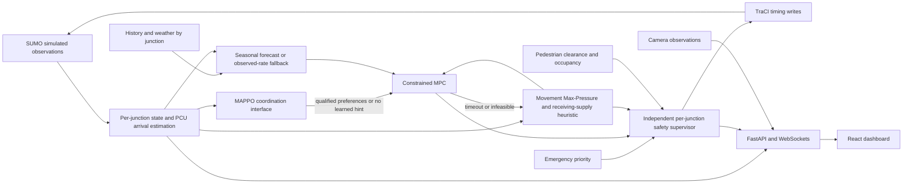

> Historical milestone record. FINAL_DEMO_REPORT.md supersedes current status and documents the Stage 3 occupancy correction; earlier weights/performance observations are not current validation.

# Stage 2 integrated hybrid research controller

Latest stage: 2026-10-22. This extends the saved Stage 1 prototype. Original SUMO networks, camera pipeline, historical forecasts, pedestrian protection and emergency handling are retained. It does not establish road certification, trained-policy usefulness or controller superiority.

## Actual architecture



Camera observations remain observational. They do not replace SUMO's signal feedback, pedestrians or internal-occupancy safety observations. Road-camera signal actuation is outside this implementation.

`backend/app/services/hybrid_network.py` is shared by the operational corridor runtime and `app/rl/sumo_env.py`. It builds separate readers, estimators, emergency handlers, MPC/Max-Pressure controllers and independent supervisors for A0/B0. All controller-originated program and duration writes remain inside `signal_supervisor.py` / `pedestrian_supervisor.py`. MAPPO's coordination interface imports no TraCI and cannot write signals.

Runtime modes: `sumo_fixed_time`, `max_pressure`, `mpc`, `hybrid`. Hybrid requests qualified MAPPO preferences; absent or rejected weights produce no learned hint and supervised MPC continues. MPC timeout/infeasibility uses the existing Max-Pressure recommendation path, still subject to the supervisor. Invalid safety feedback, illegal transitions, occupied clearance/fairness infeasibility or detected corridor collisions pause simulation instead of switching to unchecked actuation. Fixed time is SUMO's native program baseline, not an adaptive write bypass.

## Controller changes

- Clearance occupancy is restricted to each controlled junction's internal lanes; another junction's occupancy no longer holds its all-red.
- Vehicle supervisors now verify observed cyclic phase order and elapsed service/clearance, in addition to approved program/state, min/max green, maximum red and occupancy. Timing decisions include a bounded audit history. Pedestrian supervisors retain exclusive walks, 15-second geometry-based clearance on the supplied network, stopped-walker holds and fault pauses when safe release becomes infeasible.
- Green extensions reserve the following clearance when checking maximum-red fairness. Invalid MPC candidates are skipped individually. Emergency priority still obeys legal phase order, service/clearance and fairness; it cannot jump to arbitrary green.
- Emergency handlers accept per-junction incoming-edge and route maps, use the next route edge when deciding served movements, avoid per-junction ID collisions, and retain priorities for observed vehicles as they enter another junction. Local injection routes cross the selected junction; they do not imply a complete network emergency route demonstration.
- Max-Pressure reports actual movement-level upstream/downstream queued PCU and spillback penalties. MPC's receiver heuristic follows observed next-route-edge weights; with no observed vehicles it uses the opposite approach as an explicit straight-route fallback. This is not movement-level flow optimization or a proof against spillback.
- The estimator now emits observed PCU/s as well as vehicle/s, aligning MPC arrivals with queue/saturation units. Class PCU weights and default 0.5 PCU/s saturation remain uncalibrated research parameters.
- History CSV accepts optional `junction_id` (default `center` for existing files). Duplicate/overlap checks and predictions are scoped to the junction; A0 history cannot silently feed B0. Forecast mean trajectories feed MPC; heuristic uncertainty remains diagnostic, not robust optimization. Missing/stale/history-disabled/example-blocked inputs use measured PCU arrivals.
- `seed` and `paused=true` API options permit repeatable initial state. New unseeded sessions retain SUMO's prior default seed **23423** (verified from its saved option template); they do not inherit a previous session's research seed. `mpc_budget_ms=0` deliberately exercises timeout fallback; budgets are finite, bounded to 0–1000 ms, and configurable only when starting a stopped simulation.

## MAPPO status and gates

The shared actor consumes each junction's 8 local features: four normalized queues, two vehicle-green indicators, remaining phase time and mean downstream occupancy. The centralized critic consumes the concatenated two-junction observations and returns per-agent values. Binary joint actions mean release/hold **preferences** to MPC, not phases. The current MPC objective adds a bounded preference penalty; emergency service and independent safety constraints can override it.

Rewards use measured queue, current wait, downstream spillback and maximum-red age penalties plus shared actual arrivals. This is a research objective, not a demonstrated socially optimal reward. PPO/GAE, clipped actor/value updates, checkpoint/RNG saving/loading and deterministic inference are executable. The training integration test verifies changed actor **and critic** parameters, loaded deterministic actions, local-only actor dependence, joint preferences reaching both MPCs, and both supervisors participating.

Stage 2 smoke command:

```powershell
.\backend\.venv\Scripts\python.exe scripts/train_mappo.py --updates 2 --rollout-steps 32 --seed 84 --checkpoint .checkpoints/stage2-mappo-smoke.pt
```

Actual result: 64 joint decision steps across seeds 84/85, 160 simulated seconds per update, finite losses. An identical repeat produced exactly equal actor/critic state parameters and update reports; see `.checkpoints/stage2-reproducibility.json`. This is training execution only. The original 48-step smoke checkpoint is preserved. Neither is a useful trained policy claim.

`scripts/qualify_mappo.py` checks finite deterministic inference and binds its report to checkpoint SHA-256 and a controller/network fingerprint. Before closed-loop qualification it requires at least 1024 training decisions. This threshold is a conservative project guard, not a guarantee of learning. The operator must choose seeds absent from the training runs; training seed overlap is not automatically inferred from legacy checkpoints. It then requires at least three distinct held-out seeds, at least 240 simulated seconds per seed and zero supervisor/conflict/fairness/collision faults. This qualifies **supervised research evaluation**, not road use or performance improvement. Architecture changes invalidate old reports. Qualification data is operator-controlled provenance, not a signed security attestation.

The current 64-step checkpoint passes numerical checks but receives `insufficient_training`, `eligibleForEvaluation: false`. It remains disabled. `scripts/evaluate_mappo.py --mode mappo` refuses missing/ineligible/mismatched validation reports. No unqualified learned-policy evaluation is performed in Stage 2. Training rollouts deliberately use the learning actor through supervised MPC; they are not represented as validated policy evaluations.

For future trained checkpoints:

```powershell
.\backend\.venv\Scripts\python.exe scripts/qualify_mappo.py --checkpoint PATH.pt --output validation.json --seeds 101 102 103 --seconds 240
.\backend\.venv\Scripts\python.exe scripts/evaluate_mappo.py --mode mappo --checkpoint PATH.pt --validation validation.json --seeds 104 105 --steps 48
```

Only an eligible matching report may be selected with `SYNCHROFLOW_MAPPO_CHECKPOINT` and `SYNCHROFLOW_MAPPO_VALIDATION` before backend startup. Missing torch/weights/reports, invalid dimensions/actions, nonfinite observations or inference failures preserve no-hint MPC fallback. Runtime status distinguishes training/inference readiness, qualified research inference and failed inference fallback. The qualified-checkpoint positive runtime path still needs an actually trained/qualified checkpoint; this sprint supplies no such policy.

Safe baseline evaluation (no policy required):

```powershell
.\backend\.venv\Scripts\python.exe scripts/evaluate_mappo.py --mode mpc --steps 24 --seeds 96 97 --output .checkpoints/stage2-mpc-evaluation.json
```

## Startup and dashboard

Existing startup remains:

```powershell
.\backend\.venv\Scripts\python.exe scripts/run_dev.py
```

The helper refuses occupied ports and leaves unrelated services untouched. Open http://127.0.0.1:3001; backend docs http://127.0.0.1:8001/docs. Restart existing processes to load saved Python changes. SUMO-only operation needs neither camera libraries nor torch.

Select **Two-junction research corridor** and **Hybrid MPC + qualified MAPPO recommendations**, then Start. Both A0/B0 show actual approach counts/queues/waits, signals, Max-Pressure scores/movement details, MPC choices/fallback, forecast availability and supervisor decisions. Emergency controls select A0/B0. The corridor has no pedestrian crossings; verify pedestrian protection on the separate supplied pedestrian network. Primary legacy approach telemetry is explicitly A0, avoiding double-counting it as a network total. Stopped-run metrics are labeled historical.

Measured metrics include actual network arrivals, throughput (arrivals/time), integrated approach queue vehicle-seconds and per-agent research rewards. These are run-specific, not comparative improvement claims. Existing camera/forecast telemetry and clearly labeled demonstration tabs remain available.

API equivalents:

```powershell
Invoke-RestMethod 'http://127.0.0.1:8001/api/v1/sumo/start?scenario=corridor&controller=hybrid&seed=73&paused=true' -Method Post
Invoke-RestMethod 'http://127.0.0.1:8001/api/v1/sumo/step' -Method Post
Invoke-RestMethod 'http://127.0.0.1:8001/api/v1/sumo/status'
```

GET `/sumo/status` and WebSocket `/sumo/ws` now include `junctions`, `metrics`, `hybridPipeline`, `seed`, and MAPPO availability/status. Existing single-junction keys remain compatible. Emergency JSON accepts optional `junctionId`; corridor default is A0. `GET /forecast?junction_id=A0` selects correctly scoped history. Weather, forecast and camera configuration remain as documented in STAGE1_IMPLEMENTATION.md.

## Reproducible verification

Before modifications: **83 backend tests passed in 226.40 s**, one existing warning; frontend build, TypeScript and eight groups passed. All 151 Stage 1 source hashes match the preserved source archive; source/artifact archives and their separate copies verified.

New targeted verification: eight unit/actual-SUMO integration tests passed in 78.93 s. Includes actual timing-write-boundary validation, both junctions' cyclic stages, real emergency completion, forced MPC timeout, missing-policy fallback and fault pause. Final combined regression is recorded in TEST_RESULTS.md.

The standalone verifier uses real TCP HTTP/WebSocket connections and actual SUMO; it refuses to take over an active simulation. Start a disposable backend:

```powershell
$env:DEBUG='false'
cd backend
.\.venv\Scripts\python.exe -m uvicorn app.main:app --host 127.0.0.1 --port 8022
```

Then from the project root:

```powershell
.\backend\.venv\Scripts\python.exe scripts/verify_hybrid.py --base-url http://127.0.0.1:8022/api/v1 --output .checkpoints/stage2-end-to-end.json
```

Cases cover single adaptive control, protected pedestrians, opposing-approach emergency priority, two-junction hybrid control and zero-budget solver fallback. Each case compares actual WebSocket and REST time/metrics, checks network permissions and records measured outcomes. Results are checkpointed after each completed case. No simulated camera outputs or learned-policy claims are substituted.

Frontend: `npm.cmd run build`, `npm.cmd run lint`, `npm.cmd test`, `npm.cmd run test:e2e`. With `SYNCHROFLOW_CAMERA_CONFIG` set to the existing real-video config, three browser tests include actual camera counts and multi-junction dashboard state. Without video config that optional browser test is explicitly skipped. Backend real-video test environment variables remain documented in Stage 1.

### Final external execution outcomes

All cases used explicit seed 95, paused initial state, actual HTTP/WebSocket/SUMO paths and no learned policy. Queues are discrete measured vehicle-second integrals, not comparative delay savings.

| Case | Simulated seconds | Arrived vehicles | Queue vehicle-seconds | Emergency |
|---|---:|---:|---:|---|
| single_adaptive | 140 | 43 | 875 | not injected |
| pedestrian_protection | 180 | 47 | 2766 | not injected |
| emergency_priority | 180 | 48 | 2860 | completed |
| multi_junction | 180 | 193 | 7460 | completed |
| solver_timeout_fallback | 80 | 37 | 2371 | not injected |

Every case matched REST/WebSocket time and metrics, retained compatible permissions, and completed without runtime error. Both injected emergency requests completed. Pedestrian cases observed real walkers and 15-second clearance; zero-budget case observed Max-Pressure fallback. Report: `.checkpoints/stage2-end-to-end.json`.

Final backend regression: **90 passed in 303.87 s**, one existing warning. Actual Edge browser: **3 passed in 27.6 s**. Build, TypeScript, eight frontend test groups, startup smoke, optional-import startup and pip check pass. See TEST_RESULTS.md for the seed-default regression and correction.

## Remaining work

Full MAPPO training and held-out qualification, positive qualified-policy runtime validation, calibrated reward/demand/saturation/receiver models, broader networks and multi-seed comparative benchmarking remain. Camera field accuracy/live hardware/surveyed calibration and real historical forecast validation remain from Stage 1. Forecast uncertainty is not robust MPC, receiving supply remains a heuristic, and safety is validated only on supplied SUMO scenarios. The two-junction corridor does not validate combined multi-junction pedestrian networks. No optimization superiority, useful trained coordination or real-road safety claim is made.

Git remains unavailable; recovery archives and artifacts with verified manifests and separate copies are recorded in `.checkpoints/STAGE2_RECOVERY.json`. Existing Stage 1 and older known-good archives are preserved.
